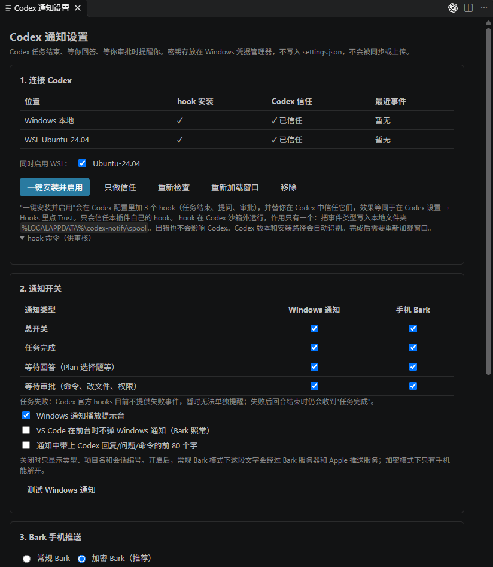

# Codex Notify

English | [中文](README.md)

When you use Codex (the official OpenAI extension) in VS Code, it does not tell you when a **task finishes**, when it is **waiting for your answer**, or when it **needs your approval**. This extension shows a **Windows notification** at those moments and can also push to **Bark on iPhone**.

<!--  -->

## Features

- 🔔 Three notification types, each routed to Windows, Bark, or both:
  | Type | When |
  | --- | --- |
  | Task finished | A Codex turn ends |
  | Waiting for answer | Codex asks you a question (e.g. Plan-mode choices) |
  | Waiting for approval | Codex wants to run a command, edit files or get a permission |
- 📱 Bark **plain** or **encrypted** push (AES-128/192/256, CBC or GCM)
- 🔐 Keys are stored in **Windows Credential Manager**, never in settings.json, never synced
- 🖥️ Works for both **local Windows windows** and **WSL remote windows**
- 🧩 Uses only official **Codex hooks**. It does not change how Codex starts and installs no executable, so a problem in this extension cannot stop Codex from launching.
- ⚙️ Settings panel with **one-click setup**; Codex version and install path are detected automatically

## Install

1. Download the latest `codex-notify-x.y.z.vsix` from [Releases](../../releases).
2. In VS Code, open Extensions → `…` → **Install from VSIX…**
   Or from the command line: `code --install-extension codex-notify-x.y.z.vsix`
3. The settings panel opens automatically (later: click **🔔 Codex** in the status bar).

> Requirements: VS Code on Windows 10/11 with the official Codex extension (`openai.chatgpt`). For WSL, `python3` must be available in the distro (Ubuntu has it by default).

## Usage

1. **Connect Codex**: in section 1, tick the WSL distros you use, click **"一键安装并启用" (Install & enable)**, then **"重新加载窗口" (Reload window)**.
2. **Choose notifications** per type and channel in section 2.
3. **Bark** (optional): choose plain or encrypted, then paste your device key (or the whole URL copied from the Bark app). For encrypted mode, set the same algorithm (by key length: 16/24/32 chars → AES128/192/256), mode and key in Bark → Settings → Push Encryption, and leave IV empty.
4. Use the **test** buttons.

After a Codex update, if the panel says a hook was *modified*, click **"只做信任" (Trust only)**.

## How it works

```
Codex ──(official async hook)──▶ hook script ──writes──▶ %LOCALAPPDATA%\codex-notify\spool
                                                                   │
                     VS Code extension (Windows side) ◀──reads─────┘
                          ├─▶ Windows toast
                          └─▶ Bark (HTTPS, optionally encrypted)
```

One-click setup trusts **only this extension's three hooks** through the official Codex app-server API (`hooks/list` + `config/batchWrite`). This is the same thing that happens when you click "Trust" in Codex Settings → Hooks. See [docs/ARCHITECTURE.md](docs/ARCHITECTURE.md).

## Privacy & security

By default a notification contains only the type, the project folder name and a 6-character session tag, with no conversation content. An optional "include summary" switch adds the first 80 characters. In plain Bark mode that text passes through the Bark server and Apple's push service; in encrypted mode only your phone can read it. Encryption failures never fall back to plaintext. See [SECURITY.md](SECURITY.md).

## Known limitations

- Codex hooks currently have no "turn failed" event; a failed turn still produces *Task finished*.
- *Waiting for approval* fires when Codex enters the approval flow, even if an automatic reviewer approves it afterwards.
- Windows only for now.
- VS Code must be running. Events older than 15 minutes are dropped.

## Development

```bash
npm test                        # Node 18+ and Python 3.8+, no npm install needed
python3 scripts/build_vsix.py   # builds dist/*.vsix and a .sha256 file
```

To release: bump `version` in `package.json`, update `CHANGELOG.md`, and push a `vX.Y.Z` tag. GitHub Actions tests, builds and publishes the release.

## License

[MIT](LICENSE). Not affiliated with OpenAI or Bark.
