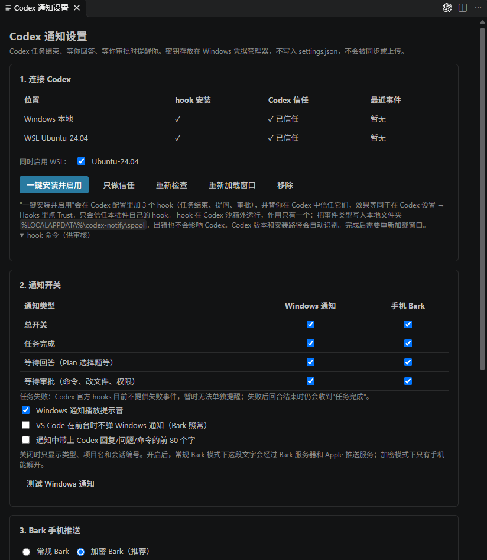

# Codex Notify

[English](README.en.md) | 中文

在 VS Code 里用 Codex（OpenAI 官方扩展）时，**任务做完了、在等你回答、在等你批准**，它不会提醒你。这个插件会在这些时候弹出 **Windows 通知**，同时（可选）推送到 **iPhone 的 Bark**。



## 功能

- 🔔 三类提醒，每类可以分别选择发到 Windows、Bark，或两边都发：
  | 类型 | 什么时候触发 |
  | --- | --- |
  | 任务完成 | Codex 一轮回复结束 |
  | 等待回答 | Codex 在问你问题（例如 Plan 模式的选择题） |
  | 等待审批 | Codex 要执行命令、改文件或申请权限，需要你批准 |
- 📱 Bark 支持**常规推送**和**加密推送**（AES-128/192/256，CBC 或 GCM）
- 🔐 密钥存在 **Windows 凭据管理器**：不写进 settings.json，不会被同步或上传
- 🖥️ 同一个插件同时支持 **Windows 本地窗口** 和 **WSL 远程窗口**
- 🧩 只用 Codex **官方 hooks**：不改 Codex 的启动方式，也不放任何 exe。插件出问题也不会让 Codex 打不开
- ⚙️ 图形化设置面板，**一键安装并启用**，自动识别 Codex 版本和安装路径

## 安装

1. 到 [Releases](../../releases) 页面下载最新的 `codex-notify-x.y.z.vsix`
2. 在 VS Code 中：扩展视图 → 右上角 `…` → **从 VSIX 安装…**，选中下载的文件
   命令行安装：`code --install-extension codex-notify-x.y.z.vsix`
3. 安装后会自动打开设置面板（以后点状态栏右下角的 **🔔 Codex** 打开）

> 要求：Windows 10/11 上的 VS Code，已安装 OpenAI 官方 Codex 扩展（`openai.chatgpt`）。使用 WSL 时需要 WSL 里有 `python3`（Ubuntu 默认自带）。

## 使用

1. **连接 Codex**：在面板第 1 栏勾选要启用的 WSL 发行版，点 **"一键安装并启用"**，完成后点 **"重新加载窗口"**。
2. **选择通知**：在第 2 栏的表格里，按类型分别勾选 Windows 和 Bark。
3. **设置 Bark**（可选）：
   - 选择 **常规** 或 **加密**
   - 粘贴设备 Key。也可以直接粘贴 Bark App 里复制的整条链接，插件会自动提取 Key 和服务器地址
   - 加密模式：在 iPhone Bark → 设置 → **推送加密** 中，按 Key 长度选择 AES128/192/256，模式和面板保持一致，填入同一个 Key，IV 留空
4. 点 **测试** 按钮，确认能收到通知。

**更换 Bark Key**：在手机上重置 Key 后，在面板里重新保存新 Key 即可。

**Codex 升级后**：如果面板显示"已修改，需要重新信任"，点 **"只做信任"**。

## 工作原理

```
Codex ──(官方 hook，异步)──▶ hook 脚本 ──写入──▶ %LOCALAPPDATA%\codex-notify\spool
                                                         │
                         VS Code 插件（Windows 端）◀──读取──┘
                              ├─▶ Windows 通知
                              └─▶ Bark（HTTPS，可加密）
```

- hook 脚本只做一件事：把事件类型、项目名和会话 ID 写进本地文件夹。它不联网，也不读取密钥，并且是异步执行的，出错也不会拖慢或阻塞 Codex。
- "一键启用"会调用官方 Codex app-server 的 `hooks/list` 和 `config/batchWrite` 接口，**只信任本插件自己的 3 个 hook**。效果等同于你在 Codex 设置 → Hooks 里点 "Trust"。
- 详细设计见 [docs/ARCHITECTURE.md](docs/ARCHITECTURE.md)。

## 隐私与安全

- 默认通知里**只有类型、项目文件夹名和一个 6 位会话编号**，不包含对话内容。
- 可以在面板中打开"带上回复摘要"（前 80 个字）。常规 Bark 模式下，这段文字会经过 Bark 服务器和 Apple 推送服务；加密模式下只有你的手机能解开。
- 加密失败时**不会**退回明文发送。
- 详见 [SECURITY.md](SECURITY.md)。

## 已知限制

- Codex 官方 hooks 目前没有"任务失败"事件。失败的那一轮结束时，仍然会收到"任务完成"。
- "等待审批"在 Codex 进入审批流程时就会触发。如果之后被自动审批通过了，这条提醒也已经发出。
- 只支持 Windows 上的 VS Code。macOS、Linux 桌面暂不支持（欢迎 PR）。
- 需要 VS Code 处于运行状态（Codex 本来就在 VS Code 里运行）。超过 15 分钟的积压事件会被丢弃。

## 卸载

1. 在面板里点 **"移除"**，删除写入 Codex 的 hook。
2. 在 VS Code 扩展视图里卸载 Codex Notify。
3. （可选）在 Windows **凭据管理器** 里删除 `codexNotify` 相关条目。

## 开发

```bash
npm test                 # 单元测试（Node.js 18+、Python 3.8+），无需 npm install
python3 scripts/build_vsix.py   # 打包到 dist/，同时生成 .sha256
```

- 不依赖任何 npm 包，也不需要构建步骤；源码就是发布的代码。
- 打包脚本只打包白名单里的文件，并扫描密钥。你可以新建一个 `.local-denylist` 文件（已被 git 忽略），每行写一个你的用户名、路径或密钥，包含这些内容的文件会被拒绝打包。
- 发布新版本：修改 `package.json` 的 version，更新 `CHANGELOG.md`，然后推送 `vX.Y.Z` 标签。GitHub Actions 会自动测试、打包并创建 Release。

## 许可证

[MIT](LICENSE)

本项目与 OpenAI、Bark 均无隶属关系。
